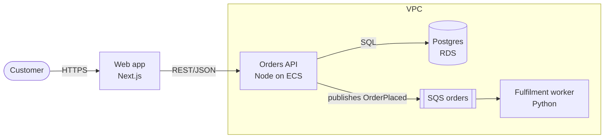
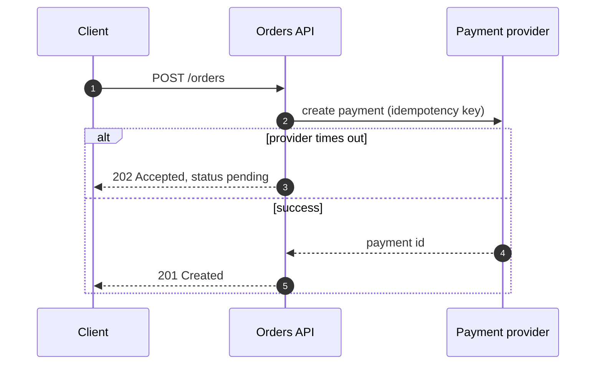
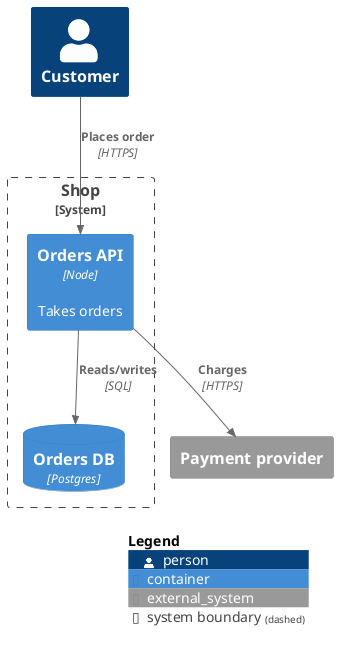

# Diagram syntax cheat sheet

Short, working starting points. Check the tool's documentation for the version installed; Mermaid's `C4` and `architecture-beta` diagram types are still marked experimental or beta.

## Mermaid

Container view as a flowchart (renders everywhere Mermaid does):



Sequence with a failure path:



C4 (experimental): `C4Context`, `C4Container`, with `Person(...)`, `System(...)`, `Container(...)`, `Rel(from, to, "label", "tech")`, `System_Boundary(id, "label") { ... }`.

Architecture (beta, Mermaid 11.1+): `architecture-beta`, `group api(cloud)[API]`, `service db(database)[Database] in api`, edges like `db:L -- R:server`. Built-in icons are `cloud`, `database`, `disk`, `internet`, `server`; other icon packs must be registered at render time.

## D2

```d2
direction: right
customer: Customer {shape: person}
aws: AWS {
  api: Orders API\n(Node, ECS)
  db: Postgres (RDS) {shape: cylinder}
  q: SQS orders {shape: queue}
  api -> db: SQL
  api -> q: publishes OrderPlaced
}
customer -> aws.api: HTTPS
```

- Icons: `api: Orders API {icon: https://icons.terrastruct.com/aws%2FCompute%2FAmazon-Elastic-Container-Service.svg}` (any reachable SVG URL or local path works).
- Layout engines: `--layout dagre` (default) or `--layout elk`. Live preview: `d2 --watch in.d2 out.svg`.
- Steps for animation: put each stage in `steps: { 1: {...} 2: {...} }`, then `d2 --animate-interval=1500 in.d2 out.svg`. Layers export best as a multi-page PDF.

## PlantUML with C4-PlantUML



AWS icons: the AWS Icons for PlantUML project provides `!include` files per service; pin the release you include rather than pointing at a moving branch.

## draw.io

- A `.drawio` file is XML (`mxfile` > `diagram` > `mxGraphModel` > `root` > `mxCell`). Editing it by hand works for small changes; for new diagrams, generate cells with `vertex="1"` and `edge="1" source="..." target="..."` and lay them out on a grid.
- Built-in shape libraries cover AWS (styles beginning `mxgraph.aws4`), Azure and Google Cloud. Copy a style string from a shape placed in the app instead of guessing it.
- Export: `drawio --export --format svg --embed-diagram -o out.drawio.svg in.drawio`; `--format png --scale 2` for raster; `--all-pages` or `--page-index N` for multi-page files. On a headless Linux box, run it under `xvfb-run -a`.

## Official icon sets

- AWS Architecture Icons: published by AWS on its architecture icons page, with usage guidelines.
- Azure architecture icons: published by Microsoft in the Azure Architecture Center, with terms of use.
- Google Cloud icons: published by Google Cloud for architecture diagrams.

Download the current set from the provider rather than copying icons from other diagrams, and keep the provider's names on the shapes.
